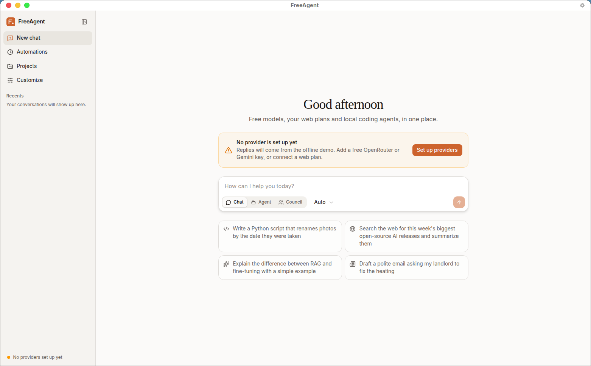
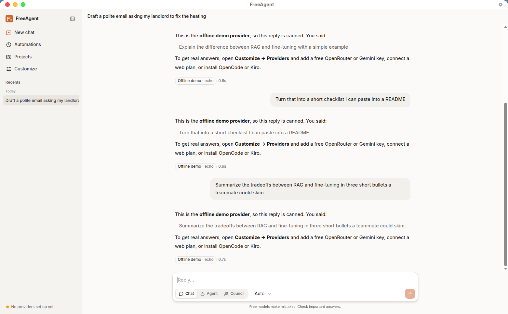
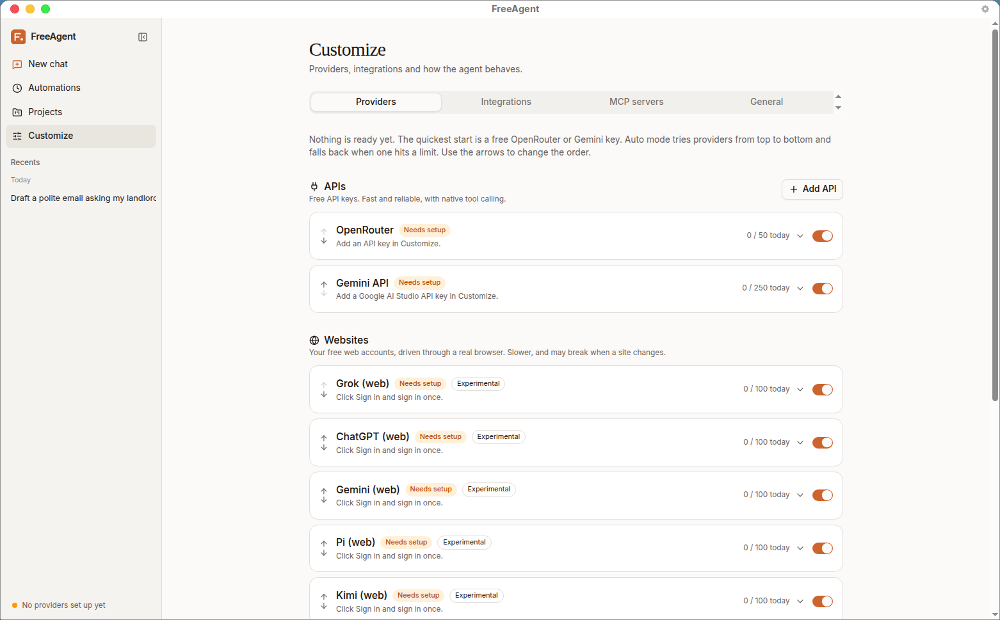
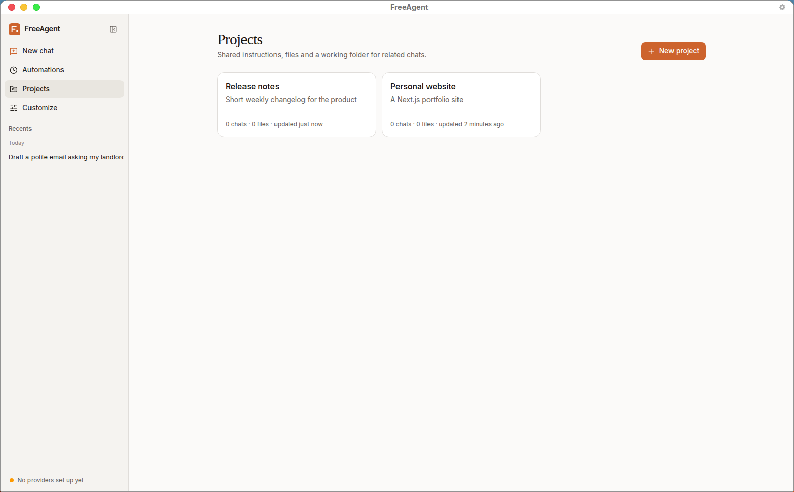
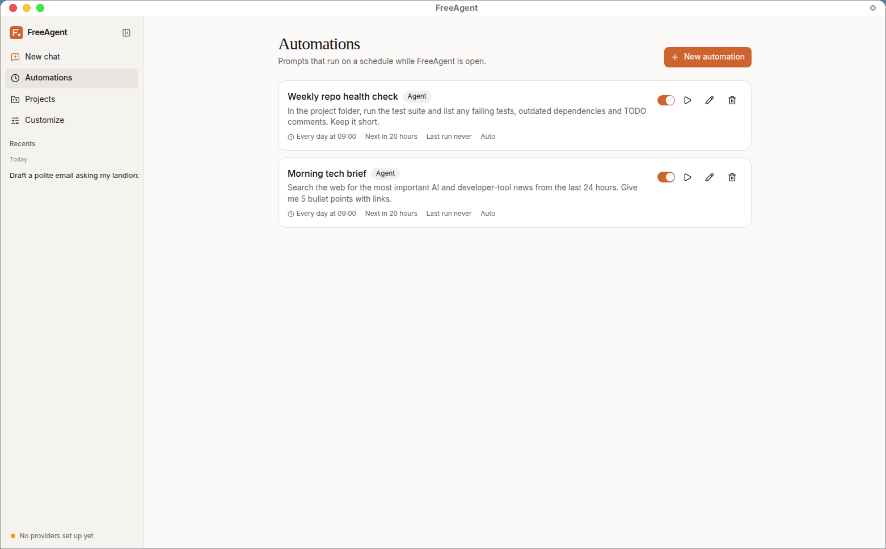
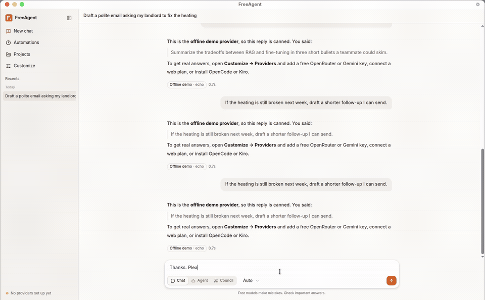

# FreeAgent

A desktop AI agent that does its work with the free AI you already have:

- **API keys:** OpenRouter and Google Gemini (AI Studio), plus any OpenAI-compatible endpoint you add as a custom API.
- **Free web plans:** Grok, ChatGPT, Gemini, Claude, DeepSeek, Pi, Kimi and Z.ai, driven through a real browser that you sign in to once.
- **Local coding agents:** OpenCode and Kiro CLI.

The left sidebar has **New chat**, **Automations**, **Projects** and **Customize**, plus your recent chats.

FreeAgent also runs a local server, so other tools can use your free providers:

- **Claude Code** can point at its Anthropic-compatible endpoint.
- **Cursor, Continue, Aider and OpenCode** can use its OpenAI-compatible endpoint.

## Screenshots

New chat, with the offline demo ready until a provider is configured:



A chat in the offline demo. Replies are canned until you add an OpenRouter or Gemini key, or connect a web plan:



Customize → Providers:



Projects and automations:




## Demo

Typing a follow-up in the offline demo. The reply quotes the message and points at provider setup.



A video of the same interaction: [chat-demo.mp4](docs/media/chat_demo.mp4).

## What it does

| Area | What you get |
| --- | --- |
| Chat | Streaming replies with Markdown and code. Pick **Auto**, Auto · Code / Fast / Long context / Vision / Reasoning, a specific provider, or a specific model. |
| Modes | **Chat** answers only. **Agent** can call tools: read, write and list files, run shell commands and code, search and fetch the web, drive a browser, hand a task to OpenCode or Kiro, and use MCP tools. **Council** asks several providers and merges their answers. |
| Routing | Providers are tried in your order. On a rate limit, quota error, timeout or login problem, FreeAgent moves to the next provider and puts the failing one on a short cooldown. Daily request limits are tracked per provider. |
| Approvals | In Agent mode, writing files and running commands wait for **Allow** or **Deny**, unless you turn on auto-approve. |
| Projects | Shared instructions, text files used as context, and a working folder for the agent and coding apps. |
| Automations | Saved prompts that run on a cron schedule or on demand, with a stored run history. |
| Customize | Provider keys (encrypted on disk), browser sign-ins, CSS selector overrides for the websites, provider order, MCP servers, gateway URLs, theme and agent settings. |

## Run it locally

You need **Node.js 22.13 or newer** (24 recommended) and **pnpm 10**.

```bash
pnpm install          # also downloads the Electron binary
pnpm dev              # builds the server, then opens the desktop app
```

The desktop app starts the server in the background and connects to it. Open **Customize → Providers** to set things up. The quickest start is a free OpenRouter or Gemini key.

Website providers need Playwright's Chromium once:

```bash
pnpm browsers
```

Other commands:

```bash
pnpm test             # vitest: router fallback, agent loop, gateway translation, parsers
pnpm typecheck        # all packages
pnpm build            # server bundle + desktop app (output in apps/desktop/out)
pnpm --filter @freeagent/desktop build:linux   # or build:mac / build:win for an installer
```

### Headless server (no desktop window)

```bash
pnpm --filter @freeagent/server build
pnpm server           # http://127.0.0.1:47821
```

| Variable | Default | Meaning |
| --- | --- | --- |
| `FREEAGENT_PORT` | `47821` | Server port |
| `FREEAGENT_HOST` | `127.0.0.1` | Bind address. Keep it on loopback unless you know why you need otherwise. |
| `FREEAGENT_DATA_DIR` | `~/.freeagent` | Database, token, keys and browser profiles |
| `FREEAGENT_TOKEN` | generated into `<dataDir>/token` | Bearer token for every API call |
| `FREEAGENT_SECRET_KEY` | generated into `<dataDir>/secret.key` | 32-byte key, base64-encoded, that encrypts stored API keys |

If the desktop app finds a headless server already running on the same data folder, it reuses that server.

## Setting up providers

| Provider | How |
| --- | --- |
| OpenRouter | Create a key at [openrouter.ai/settings/keys](https://openrouter.ai/settings/keys). It defaults to the `openrouter/free` router, which picks a free model. You can pin a `:free` model in the provider settings. |
| Gemini API | Create a key at [aistudio.google.com/apikey](https://aistudio.google.com/apikey). The default model is `gemini-2.5-flash`. |
| Custom API | Click **Add API** under **Customize → Providers**. Enter a name and the base URL of any OpenAI-compatible Chat Completions endpoint. The API key and model are optional; without a key, requests go out without an `Authorization` header. |
| Grok, ChatGPT, Gemini (web), Claude (web), DeepSeek, Pi, Kimi, Z.ai | Run `pnpm browsers` once. Then click **Sign in**, log in in the window that opens, close it, and click **Check login**. ChatGPT can also work without an account once you have connected it; the other sites need a sign-in. Each site keeps its own browser profile in `<dataDir>/browser-profiles/`. These are **experimental**: sites change their markup and add bot checks. If replies stop arriving, edit the selectors under **Selectors**, or turn on **Show browser windows** to solve a captcha. In Agent mode, tool calls are emulated through text: the site gets a compact tool list, replies with `tool_call` blocks, and gets one correction prompt if a block is malformed. This works with **Web chat: send message only** turned on. API providers are still more reliable for long tool runs. To use a specific model on a site, type its name in **Model name** (for example `Argon` on Gemini, `Expert` on Grok, `Sonnet` or `Opus` on Claude). Before each chat FreeAgent opens the site's model menu and clicks the matching entry; if nothing matches, the error lists what the menu offers. Leave it empty to keep the site's current model. Pi has no model menu. |
| OpenCode | Install it ([opencode.ai](https://opencode.ai/docs)) and run `opencode auth login` once. FreeAgent starts `opencode serve` and sends tasks to it in the project folder. |
| Kiro | Install `kiro-cli`, then run `kiro-cli login` or paste a `KIRO_API_KEY`. Tasks run with `kiro-cli chat --no-interactive`. |

App providers aren't used for ordinary Auto chat. Use them by picking them directly, or let the agent call `delegate_to_app`.

## Free API sites

Places to get a free API key:

- [APINex](https://apinex.bond/?ref=YBAKBWB2)
- [Abliteration](https://abliteration.ai/sign-up?referral_code=ref_x4J3UvbZPBQm)
- [OneKey LLM API](https://onekeyllmapi.com/)

## Using FreeAgent from other tools

**Customize → Integrations** shows your gateway URL, API key and ready-to-copy commands.

**Claude Code** with free models:

```bash
ANTHROPIC_BASE_URL=http://127.0.0.1:47821 ANTHROPIC_AUTH_TOKEN=<your token> claude
```

Claude model names are mapped onto the router. Sonnet and Opus go to Auto · Code, and Haiku goes to Auto · Fast. Tool use is passed through.

**OpenAI-compatible clients** use the base URL `http://127.0.0.1:47821/v1` and your token as the API key. The `model` can be:

- `auto`, `auto-code`, `auto-fast` or another auto target
- a provider id such as `openrouter`, `gemini-api`, `web-grok` or `web-deepseek`
- a provider and model, such as `openrouter::qwen/qwen3-coder:free`

`GET /v1/models` lists them all.

**Any MCP client** can use streamable HTTP at `http://127.0.0.1:47821/mcp` with `Authorization: Bearer <token>`. It exposes these tools:

- `list_providers`
- `ask_provider` (ask any free model or website)
- `run_automation`
- `search_projects`
- `delegate_to_app` (hand a coding task to OpenCode or Kiro)

## Telegram bot

`apps/telegram` is a small bot that chats with FreeAgent from Telegram. Each Telegram conversation is a normal FreeAgent chat in **chat mode**, so it also appears in the desktop app. The bot runs as its own process, uses long polling (no public URL needed) and talks to the local server.

1. Create a bot with [@BotFather](https://t.me/BotFather) and copy its token.
2. Start FreeAgent (the desktop app, or `pnpm server`).
3. Run the bot:

```bash
TELEGRAM_BOT_TOKEN=<bot token> TELEGRAM_ALLOWED_IDS=<your Telegram user id> pnpm telegram
```

If `TELEGRAM_ALLOWED_IDS` is empty, nobody can chat with the bot. Every sender gets one reply that includes their user id, so you can message the bot once, read your id from the reply and restart with it set.

| Variable | Default | Meaning |
| --- | --- | --- |
| `TELEGRAM_BOT_TOKEN` | required | Token from BotFather |
| `TELEGRAM_ALLOWED_IDS` | empty (nobody allowed) | Comma-separated Telegram user ids |
| `FREEAGENT_URL` | `http://127.0.0.1:47821` | Server URL |
| `FREEAGENT_TOKEN` | `<dataDir>/token` | Server bearer token |
| `FREEAGENT_DATA_DIR` | `~/.freeagent` | Used to find the token and the link file |
| `TELEGRAM_STATE_FILE` | `<dataDir>/telegram-links.json` | Telegram chat to FreeAgent chat links |

Commands: `/start` shows help, `/new` starts a new conversation, `/stop` cancels the current reply, `/target` shows the current target with buttons for Auto and every ready provider, and `/target <id>` sets it directly (`auto`, `auto-code`, `auto-fast`, a provider id). Only private chats and text messages are supported.

## Where data lives

Everything is stored in `~/.freeagent`, or in `FREEAGENT_DATA_DIR` if you set it:

- `freeagent.db` holds the SQLite database: chats, projects, automations, run history, provider settings and usage.
- `secret.key` or `secret.key.enc` is the encryption key for stored API keys. The desktop app protects it with the OS keychain.
- `token` is the local API token.
- `browser-profiles/` holds the signed-in browser sessions for the website providers.
- `web-sites/` holds your selector overrides.
- `workspaces/` holds the default working folders for chats and projects that don't have their own.

## Project layout

```
apps/desktop     Electron + React (electron-vite, Tailwind, shadcn/ui). Starts the server and renders the UI.
apps/server      Hono server: REST + SSE API, scheduler, OpenAI/Anthropic gateway, MCP server and stdio bridge.
apps/telegram    Telegram bot that chats with the local server (grammY, long polling).
packages/core    Providers, router, agent loop and tools, SQLite store (node:sqlite), encrypted secrets.
```

## Notes and limits

- Free tiers change often. The OpenRouter default uses its free router (`openrouter/free`), so you don't depend on one model name.
- Website automation may break the terms of service of some sites, and it can break whenever a site changes. Use it with your own accounts, and expect to adjust selectors.
- Shell and code tools run on your machine with your user's permissions. They're confined to the project folder only for file paths. Keep approvals on unless you trust the task.

## Roadmap

Checked against the current app. Shipped behavior stays in the sections above.

### Already in the app

**Chat**

- [x] **Streaming chat.** Replies stream in as Markdown, including code. Stop ends the current reply.
- [x] **Three modes.** Chat answers only. Agent calls tools. Council asks several ready providers at once and merges their answers. Council size is set in Customize (2–6).
- [x] **Auto and a pinned model.** Auto, Auto · Code, Fast, Long context, Vision and Reasoning, or one provider, or `provider::model`.
- [x] **Recent chats.** The sidebar groups them by day. A chat can be deleted. The title comes from the first message.
- [x] **Offline demo.** Until a real provider is ready, the built-in demo answers so the window is usable.
- [x] **One website thread per chat.** A saved chat keeps that site’s conversation open across turns, in Chat and Agent mode, so later turns type only the new message and later agent steps only the new tool results. A new site conversation gets a shortened prompt: up to 8K characters of project files, the last 10 earlier messages (2K characters each) and tool results cut to 6K characters.

**Routing and limits**

- [x] **Daily request count per provider.** OpenRouter defaults to 50, Gemini API to 250, each website to 100. A custom API can set its own. Customize → Providers shows today’s count. In Auto, a provider past its limit is tried last.
- [x] **Fallback.** On a rate limit, quota error, timeout, login problem or human check, FreeAgent tries the next provider and puts the failing one on a short cooldown.
- [x] **Provider order.** Move a provider up or down in Customize. Auto tries ready providers in that order. Each one can be turned off. Picking a provider by name can still fall back when that switch is on.

**Providers**

- [x] **API keys.** OpenRouter (free router and `:free` models), Google Gemini, and any OpenAI-compatible endpoint added with **Add API**. Keys are encrypted on disk. The desktop app keeps the encryption key in the OS keychain.
- [x] **Eight website plans.** Grok, ChatGPT, Gemini, Claude, DeepSeek, Pi, Kimi and Z.ai. Each has its own browser profile, **Sign in**, and **Check login**. ChatGPT can run without an account after it is connected.
- [x] **Model name on a website.** Before a new chat, FreeAgent opens that site’s model menu and clicks the matching entry. An empty name keeps the site’s current model. Pi has no model menu.
- [x] **Selector overrides.** Per-site CSS selectors can be edited and reset. Overrides are stored in `~/.freeagent/web-sites/<id>.json`.
- [x] **Website reply as Markdown.** Tables and code are read from the page. **Web chat: send message only** sends only the latest user message in Chat mode. Agent mode always sends the instructions and tools.
- [x] **Visible browser.** **Show browser windows** opens the site window, which is how a human check is solved today. Cloudflare and DeepSeek’s usage dialog are detected and reported.
- [x] **Local coding agents.** OpenCode, Kiro CLI and the Claude Code CLI. They are picked directly, or the agent calls `delegate_to_app`.

**Agent tools**

- [x] **Built-in tools.** List, read and write files, run a shell command, run code, search the web, fetch a page, and drive a headless browser (click, fill, press, then read text or links). File paths stay inside the project folder.
- [x] **Approvals.** Writing a file, running a command and handing work to a coding app wait for **Allow** or **Deny**, unless auto-approve is on.
- [x] **Step cap.** Agent mode stops after the step limit in Customize (default 12) and says so.
- [x] **Your own MCP servers.** A stdio or HTTP MCP server added under Customize becomes extra agent tools.

**Projects and automations**

- [x] **Projects.** A name, description, shared instructions, uploaded text files, and a working folder for the agent and the coding apps.
- [x] **Automations.** A saved prompt on a cron schedule or run on demand, with the run history stored.

**Other apps can call FreeAgent**

- [x] **Local server.** The desktop app starts it, or `pnpm server` runs it headless on `127.0.0.1:47821`. Every call uses the bearer token in `~/.freeagent/token`.
- [x] **Claude Code.** An Anthropic-compatible endpoint. Sonnet and Opus map to Auto · Code, Haiku to Auto · Fast. Tool use is passed through.
- [x] **OpenAI-compatible endpoint.** `http://127.0.0.1:47821/v1` for Cursor, Continue, Aider and OpenCode. `GET /v1/models` lists auto targets, providers and `provider::model`.
- [x] **MCP server.** Streamable HTTP at `/mcp`, plus a stdio bridge and a Claude Desktop link. Tools: `list_providers`, `ask_provider` (chat or council), `run_automation`, `search_projects`, `delegate_to_app`.
- [x] **Telegram.** A long-polling bot for private text chats. `/new`, `/stop` and `/target`. An allow-list of Telegram user ids. Each Telegram chat is a normal FreeAgent chat.

**Customize → General**

- [x] **System prompt, theme and agent switches.** The system prompt is editable. Theme follows the OS, or stays light or dark. Also: auto-approve, fallback when a provider is picked by name, plain text to websites, council size and the agent step cap.

### Chat

- [ ] **Files and images in the composer.** Attach a file or image to a message. The composer is text only today. Image parts that arrive through the OpenAI or Anthropic gateway are dropped.
- [ ] **Voice in the desktop chat.** Record or upload audio and send it to a provider that accepts it.
- [ ] **Show generated media in the thread.** When a provider returns an image, audio clip or music file, save it and render it under the reply. Replies are markdown text today.
- [ ] **Edit and regenerate.** Change the last user message, or ask the same provider again, without starting a new chat.
- [ ] **Search and export.** Find a chat from the sidebar, and export one chat to a Markdown file.

### Agent

- [ ] **Plugins, skills and rules.** Load project rules (such as `AGENTS.md`), reusable skills, and plugins the agent can turn on per chat or project. A project today has one instructions field and attached text files.
- [ ] **Split a large task first.** Before tools run, break a large request into a visible list of small tasks and run them in order. The agent today plans in one prompt, may take up to the step cap, or hands the whole job to OpenCode, Kiro or Claude Code.
- [ ] **Memory across chats.** Keep a small set of facts the user asked to remember, separate from one project’s instructions.
- [ ] **Git tool.** Status, diff and commit inside the project folder, with the same approval prompt as shell commands.
- [ ] **Screenshots from the browser tool.** `browser_task` returns page text or links. Also return a screenshot when the page is the answer.

### Website providers

- [ ] **Add an unofficial website.** Register another site from Customize with its URL and selectors, next to Grok, ChatGPT, Gemini, Claude, DeepSeek, Pi, Kimi and Z.ai. Selector overrides already exist for those built-in sites. Sites live under Customize → Providers.
- [ ] **Use the site’s own tools.** From the desktop chat, open the site’s image, voice, music and task controls, and upload a file into its composer. A website provider today types one prompt and reads the text reply.
- [ ] **A second account per site.** One extra browser profile, with its own Sign in, for the same website.
- [ ] **Popups and human checks.** Close cookie banners and other dialogs that cover the prompt. When a human check appears, keep the browser window open until it is solved.

### Limits, integrations, tests

- [ ] **Harder usage limits.** Stop a provider for the rest of the day once it hits its limit, including when it is picked by name. Add an optional token cap. OpenCode, Kiro and Claude Code have no limit today, and a direct pick still runs a provider that is over its request count.
- [ ] **Telegram beyond private text.** Photos, voice notes and documents, plus Agent mode. The bot today accepts private text in chat mode.
- [ ] **Agent mode on the MCP server.** `ask_provider` accepts `chat` and `council`. Add `agent` so an MCP client can run tools, not only ask a question.
- [ ] **Notify when a long run finishes.** A desktop notification when an automation or a long agent reply ends while the window is in the background.
- [ ] **Tests for MCP, Claude Code and the web agent.** The MCP server, the Claude Code gateway, handing a task to the `claude` CLI, and keeping one website conversation open across agent steps are implemented. Missing: an automated test and a short manual checklist for each path, including one run against a local fake chat page.

